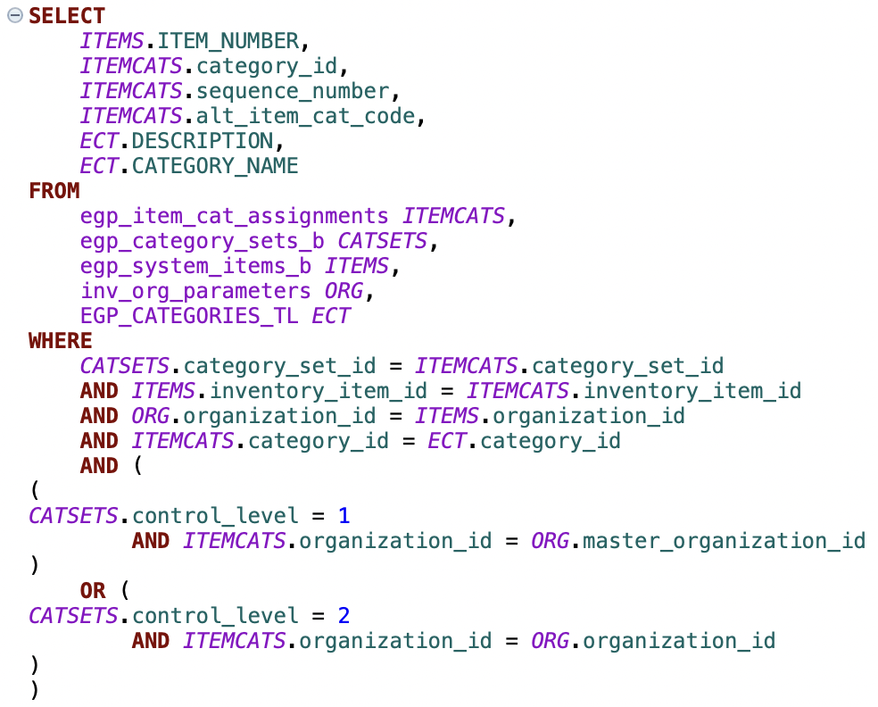

<h1 align="center">SQL Developer experience for Oracle Fusion Cloud</h1>

<p align="center">
  <strong>Run SQL queries directly against Oracle Fusion. Free. Open-source.</strong>
</p>

<p align="center">
  <a href="https://github.com/krokozyab/ofjdbc/blob/master/LICENSE.md"></a>
  <a href="https://github.com/krokozyab/ofjdbc/stargazers"></a>
  <a href="https://oraclefusionsql.com"></a>
</p>

<p align="center">
  <a href="#-quick-start">Quick Start</a> · 
  <a href="#-why-ofjdbc">Why OFJDBC</a> · 
  <a href="#-comparison-with-alternatives">Comparison</a> · 
  <a href="#-ecosystem">Ecosystem</a> · 
  <a href="#-documentation">Docs</a>
</p>

<!--[](https://github.com/krokozyab/ofjdbc/releases)-->

## The Problem

Oracle Fusion Cloud doesn't allow direct database connections. Developers and consultants are forced to use **OTBI** (limited subject areas, 65K row cap), **BI Publisher** (tiny SQL editor, multi-step process), or **paid third-party tools** — just to run a simple `SELECT` query.

**OFJDBC fixes this.** It's a lightweight JDBC driver that translates standard SQL into SOAP requests against Oracle Fusion's BI layer. Plug it into DBeaver, IntelliJ, or any JDBC-compatible tool — and query Oracle Fusion tables like a normal database.
<p align="center">
  <a href="https://www.youtube.com/watch?v=7HQwmzQriRM">
    
  </a>
</p>


## ✨ Why OFJDBC

| | OFJDBC + DBeaver | Proprietary SQL Tools | BI Publisher |
|---|:---:|:---:|:---:|
| **Price** | **Free & Open Source** | Freemium / Paid tiers | Bundled with Fusion |
| **Source Code** | ✅ MIT License | ❌ Proprietary | ❌ Oracle |
| **Platform** | Windows, macOS, Linux | Windows or Web only | Web only |
| **IDE** | DBeaver, IntelliJ, any JDBC tool | Own editor only | Own editor |
| **Multi-Database** | ✅ Same DBeaver window: Fusion + EBS + PostgreSQL + any DB | ❌ Oracle Fusion only | ❌ Oracle Fusion only |
| **Metadata Autocomplete** | ✅ Local DuckDB cache | ✅ Built-in | ❌ |
| **Export Formats** | Parquet, CSV, JSON, Excel, DuckDB, cloud storage | Excel, CSV | Excel, PDF, HTML |
| **ETL / Pipeline Support** | ✅ Airflow, NiFi, Talend, any JVM | ❌ | Limited (ESS) |
| **Cloud Data Lake Integration** | ✅ S3, GCS, Azure Blob, OCI | ❌ | ❌ |
| **BI Tool Integration** | Any tool with JDBC support: Power BI, Tableau, Looker, QuickSight, etc. | ❌ | Limited |
| **AI / MCP Server** | ✅ [ofrag](https://github.com/krokozyab/ofrag) — Claude, OpenAI, Gemini | ❌ | ❌ |
| **Programmatic Access (JVM)** | ✅ Java, Kotlin, Scala, Groovy | ❌ | REST API |

> **Bottom line:** Proprietary tools give you a query window that works with Oracle Fusion and nothing else. OFJDBC is a **standard JDBC driver** — it turns Oracle Fusion into just another data source in your existing IDE, alongside Oracle EBS, PostgreSQL, MySQL, or any other database. One tool for everything.

## 🚀 Quick Start

### 1. Download the JAR
Get the latest `orfujdbc-x.x.jar` from [Releases](https://github.com/krokozyab/ofjdbc/releases).

### 2. Upload BI Publisher Catalogs
Upload `otbireport/DM_ARB.xdm.catalog` and `RP_ARB.xdo.catalog` to  
`/Shared Folders/Custom/Financials` in your Oracle Fusion instance.

### 3. Connect

| Setting | Value |
|---|---|
| **JDBC URL** | `jdbc:wsdl://<host>/xmlpserver/services/ExternalReportWSSService?WSDL:/Custom/Financials/RP_ARB.xdo` |
| **Driver Class** | `my.jdbc.wsdl_driver.WsdlDriver` |
| **Authentication** | Fusion Username & Password, Browser SSO with MFA (`?authType=BROWSER`), **or** OAuth 2.0 client credentials for headless jobs (`?authType=OAUTH`, see [OAuth](docs/environment-variables.md#oauth-authentication)) |

### 4. Query
<p align="center">
  
</p>


👉 [**Full Setup Guide with Screenshots**](docs/setup_guide.md)  
🔐 [**SSO Browser Authentication**](docs/sso_authentication.md)

## 🔧 Key Features

**Standard JDBC Driver** — Not a standalone app, but a real JDBC driver. Use it anywhere JDBC works: DBeaver, IntelliJ DataGrip, Apache Airflow, custom Java/Kotlin apps, ETL platforms.

**Smart Metadata Cache** — Local DuckDB-based cache of Oracle Fusion metadata. Enables fast autocomplete, syntax highlighting, and table/column discovery in your IDE without querying production.

**SSO, MFA & OAuth** — Browser-based Single Sign-On with MFA support: add `?authType=BROWSER` to your JDBC URL and authenticate through your corporate identity provider. For ETL jobs and schedulers without a browser, `?authType=OAUTH` gets an OAuth 2.0 token with client credentials, caches it and renews it automatically; custom providers (e.g. a vault) plug in via `oauthProviderClass`. See [OAuth Authentication](docs/environment-variables.md#oauth-authentication).

**Automatic Pagination** — Handles large datasets transparently by injecting `FETCH FIRST` clauses. No manual pagination needed.

**`FUSION` Schema in the Tree** — All objects appear under the schema `FUSION` (Tables, Views, Indexes, …). Generated SQL uses `FUSION.TABLE` names, which Fusion accepts — secured HR views included.

**`DUCK` Schema — Embedded DuckDB Workspace** — A local DuckDB database next to Fusion, shown as schema `DUCK`. Create tables and run any SQL — joins, aggregates, window functions — in milliseconds. Import Fusion data with one statement; rows stream page by page; columns that are text in the Fusion dictionary (segments, `ATTRIBUTE1..N`, codes) stay text, the others get number, decimal, date or timestamp types inferred from the data:

```sql
CREATE TABLE DUCK.je AS SELECT je_header_id, name, default_effective_date, running_total_dr
                        FROM gl_je_headers WHERE ledger_id = xx;
INSERT INTO DUCK.je SELECT …;              -- append more Fusion rows
SELECT currency_code, SUM(running_total_dr) FROM DUCK.je GROUP BY 1;
```

One query can also mix both: `UNION` branches and parenthesized subqueries that read only `FUSION.*` tables are fetched from Fusion first, then the whole query runs locally:

```sql
SELECT l.*, f.enabled_flag
  FROM DUCK.gcc l
  JOIN (SELECT code_combination_id, enabled_flag FROM FUSION.GL_CODE_COMBINATIONS
         WHERE segment2 = 'xx') f ON f.code_combination_id = l.code_combination_id;
```

Write `DUCK.` and `FUSION.` explicitly in such queries and keep the Fusion part filtered — it is fetched in full.

The engine is always explicit: Oracle Fusion by default (unqualified names included, whatever schema the IDE has selected); DuckDB when the statement references `DUCK.x`, or for any statement prefixed with `#d` (or `#duck`). `#d` opens up everything DuckDB can do — its full SQL dialect, functions and extensions, reading and writing CSV, Parquet, JSON and Excel files, `COPY`, `SUMMARIZE`:

```sql
#d SUMMARIZE DUCK.je
#d CREATE TABLE DUCK.excel_list AS SELECT * FROM read_csv('~/Downloads/list.csv')
#d COPY DUCK.je TO '~/je.parquet'
```

The workspace `~/.ofjdbc/duck.duckdb` is shared by all your Fusion connections, so data imported from DEV, TEST and PROD can be compared in one query (`DUCK.je_dev` vs `DUCK.je_test`). Set `?duckDb=<file>` to use another file, or `:memory:` for none.

**Consultant Commands** — Run these in the SQL editor like any query:

| Command | Result |
|---|---|
| `FIND FUSION TABLE 'GL_JE%'` | Tables and views whose name or description matches the pattern (`'%journal%'` searches descriptions). Answered from the local cache in milliseconds. |
| `FIND FUSION COLUMN 'INVOICE_NUM'` | Tables and views having a matching column (`'%invoice number%'` searches column descriptions), with type, width and description. |
| `JOIN KEYS AP_INVOICES_ALL [AP_INVOICE_LINES_ALL]` | How tables join, learned from Oracle's own view definitions (all `FND_VIEWS`): join condition, number of views using it, example views. |
| `LOOKUP 'INVOICE TYPE'` | Values of a lookup type (code, meaning, description, enabled, dates); suggests similar type names when nothing matches. |
| `ESS REQUESTS ['ImportPayables%'] [LAST 20]` | Latest ESS requests (job, decoded state, submitter, start/end, elapsed, error message); `ESS REQUEST 1234567` shows one request with its parameters, properties and child requests. |
| `USER ACCESS 'john.smith'` | A user's account, roles (job/abstract/data, how provisioned) and data access (business units, ledgers, …). |
| `ORG STRUCTURE ['AT%']` | Business units with their primary ledger (currency, chart of accounts) and legal entity, then ledgers and legal entities without a business unit. |
| `VALUESET XX_COMPANY` | Values of an independent/dependent value set, or the validation SQL of a table-validated one. |
| `PROFILE '%DATE%FORMAT%'` | Profile option values at site, product and user level. |
| `EXPLAIN FUSION VIEW FND_CURRENCIES_ACTIVE_V` | Objects the view reads, the join keys between them and single-object filters, read from the full view text. |
| `DESCRIBE FLEXFIELD AP_INVOICES_ALL` | Segment → column mapping (`ATTRIBUTE1..N` / `SEGMENT1..N`) of the descriptive or key flexfields of a table, with contexts/structures, required flags and value sets. |

**Query Profiler** — Add `?profile=true` to the JDBC URL and every fetched page reports its telemetry in the IDE's Output panel: SOAP round trip vs download and parse time, payload size, whether the page was read completely, and the exact SQL sent. See [Query Profiler](docs/environment-variables.md#query-profiler-ofjdbc_profile).

**Runs Locally** — Your credentials and data never leave your machine. No third-party cloud relay, no SaaS intermediary. Fully auditable open-source code.

## 🌐 Ecosystem

Two ways into the same data: a JDBC driver for the JVM world, and an Oracle Net endpoint for everything that speaks to an Oracle database. Both talk to Fusion through the same documented BI Publisher service.

```
┌────────────────────────────────────────────────────────────┐
│                       AI / LLM Layer                       │
│       ofrag — MCP Server for Claude, Gemini, any LLM       │
│    Semantic search · SQL validation · Natural language     │
├────────────────────────────────────────────────────────────┤
│                     Data Access Layer                      │
├──────────────────────────┬─────────────────────────────────┤
│ OFJDBC (JDBC)            │ oratofusionproxy (Oracle Net)   │
│ JVM, DBeaver, Airflow,   │ SQL Developer, Excel,           │
│ any JDBC tool            │ Power BI, sqlplus, dblink       │
├──────────────────────────┴─────────────────────────────────┤
│                    Oracle Fusion Cloud                     │
│               BI Publisher SOAP Web Services               │
└────────────────────────────────────────────────────────────┘
```

| Project | What it does | Link |
|---|---|---|
| **OFJDBC** | JDBC driver — SQL access from DBeaver, IntelliJ, JVM apps | [GitHub](https://github.com/krokozyab/ofjdbc) |
| **oratofusionproxy** | Oracle Net/TNS proxy — Fusion as a real Oracle database for SQL Developer, Excel, Power BI and `dblink` from EBS | [GitHub](https://github.com/krokozyab/oracle-fusion-tns-proxy) |
| **ofrag** | AI RAG engine & MCP Server — natural language queries via Claude/Gemini | [GitHub](https://github.com/krokozyab/ofrag) |

## 💡 Use Cases

**Ad-hoc troubleshooting** — Query `GL_JE_HEADERS`, `AP_INVOICES_ALL`, `AR_PAYMENT_SCHEDULES_ALL` directly without creating OTBI reports or BI Publisher data models. Check failed ESS jobs, a user's roles and data access, or flexfield mappings with one-line [consultant commands](#-key-features).

**Local analysis** — Pull a filtered slice of Fusion into the `DUCK` schema once, then join, aggregate and re-query it in milliseconds without another round trip — or export it to Parquet/CSV with `#d COPY`.

**Data warehouse exports** — Build automated ETL pipelines with Airflow or NiFi. Export to Parquet, load into S3/BigQuery/Snowflake.

**Cloud data lakes** — Oracle Fusion → OFJDBC → DBeaver export → AWS S3 → Athena → QuickSight. Full pipeline, zero license cost.

**AI-powered analysis** — Combine with [ofrag](https://github.com/krokozyab/ofrag) to let AI agents query Oracle Fusion in natural language. The AI discovers tables semantically, validates SQL locally, and executes against Fusion.

**EBS → Fusion migration** — Migrating from Oracle EBS to Fusion Cloud? In DBeaver, open EBS (native Oracle JDBC) and Fusion (OFJDBC) side by side in the same workspace. Compare data, validate mappings, reconcile record counts — all without switching tools. This works with any database: PostgreSQL staging, MySQL, SQL Server — anything with a JDBC driver lives in one IDE.

**Cross-environment comparison** — Connect to DEV, SIT, UAT, PROD from the same DBeaver workspace. Compare data across environments side by side, or import each into the shared `DUCK` workspace and diff them in a single query.

**Integration development** — Use programmatically in Kotlin/Java to validate data during OIC integration development, reconcile source-to-target, or generate test datasets.

## ⚠️ Limitations

- **Read-only** — Oracle Fusion is queried with `SELECT` only (Oracle Fusion does not permit write access through the BI layer); writing is possible only in the local `DUCK` schema. Transaction commands (`COMMIT`, `ROLLBACK`) are ignored.
- **Performance** — SOAP transport adds overhead compared to native DB access. Automatic pagination helps, but very large exports may take time. For bulk extracts, consider BICC.
- **SQL length** — The BI Publisher data model receives the query as a PL/SQL `VARCHAR2`, so a query may be at most 32,767 bytes (UTF-8) as sent — comments are stripped, but the added pagination clause and secured-view names count. Longer queries are rejected before sending with a clear error (SQLState `54000`) instead of Oracle's `ORA-01460`.
- **Security** — Ensure usage complies with your organization's security policies and Oracle Fusion terms of service.

## 📄 Documentation

| Guide | Description |
|---|---|
| [Setup Guide](docs/setup_guide.md) | Step-by-step installation with DBeaver screenshots |
| [SSO Authentication](docs/sso_authentication.md) | Browser-based SSO with MFA support |
| [Secured Views Mappings](docs/hr_secured_views.md) | HCM secured view reference |
| [Environment Variables](docs/environment-variables.md) | Configuration options, OAuth, DUCK workspace, query profiler |
| [Programmatic Examples](programmatically_examples/) | Java/Kotlin code samples |

## 📚 Articles & Tutorials

- [Analysis of Ad-Hoc SQL Query Tools for Oracle Fusion Cloud](https://www.linkedin.com/pulse/analysis-ad-hoc-sql-query-tools-oracle-fusion-cloud-sergey-rudenko-igaif/) — Detailed comparison of available tools
- [Building Oracle Fusion → AWS S3 → Athena → QuickSight Pipelines](https://www.linkedin.com/pulse/bridging-gap-using-open-source-jdbc-driver-oracle-fusion-rudenko-i6cwf/) — End-to-end data lake tutorial
- [Query Oracle Fusion & Visualize in Apache Superset](https://www.linkedin.com/pulse/query-oracle-fusion-arrow-flight-sql-visualize-apache-sergey-rudenko-7rwlf/)
- [Export Oracle Fusion Data to Google Sheets in Minutes](https://www.linkedin.com/pulse/export-oracle-fusion-data-google-sheets-minutes-sergey-rudenko-izj4f/)
- [Replace OIC Batch ETL — ofload Reference Implementation](https://github.com/krokozyab/ofload) — Production Oracle Fusion → Autonomous Database ETL service: REST-triggered, incremental pagination, MERGE       
  idempotency, Prometheus metrics

## 🤝 Contributing

Contributions are welcome! Open a [GitHub Issue](https://github.com/krokozyab/ofjdbc/issues) for bugs or feature requests, or submit a pull request. Join the [Discussions](https://github.com/krokozyab/ofjdbc/discussions) for questions and ideas.

## 📫 Contact

- **Website:** [oraclefusionsql.com](https://oraclefusionsql.com)
- **GitHub Issues:** [krokozyab/ofjdbc/issues](https://github.com/krokozyab/ofjdbc/issues)
- **Email:** sergey.rudenko.ba@gmail.com
- **LinkedIn:** [Sergey Rudenko](https://www.linkedin.com/in/sergey-rudenko-ba/)

---

<p align="center">
  If this project saved you time or money, consider leaving a ⭐
  <br><br>
  <strong>Free and open-source.</strong> Built by an Oracle Fusion consultant, for Oracle Fusion consultants.
</p>
