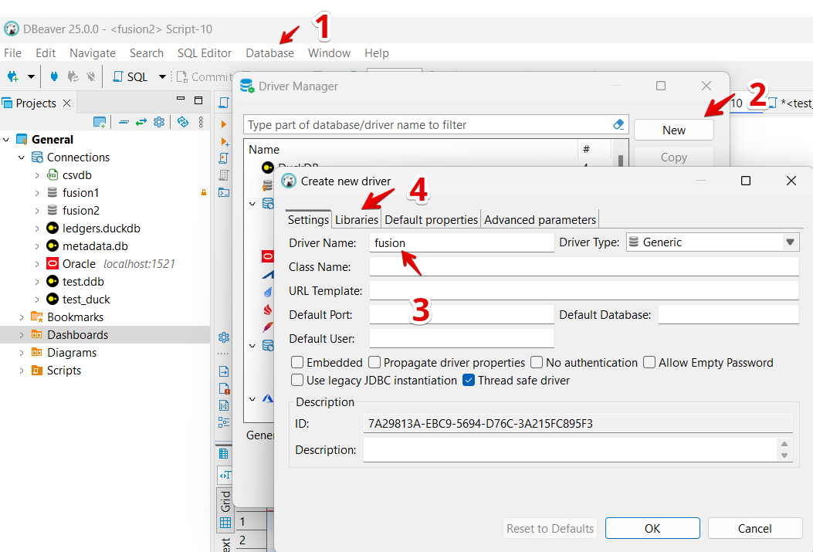
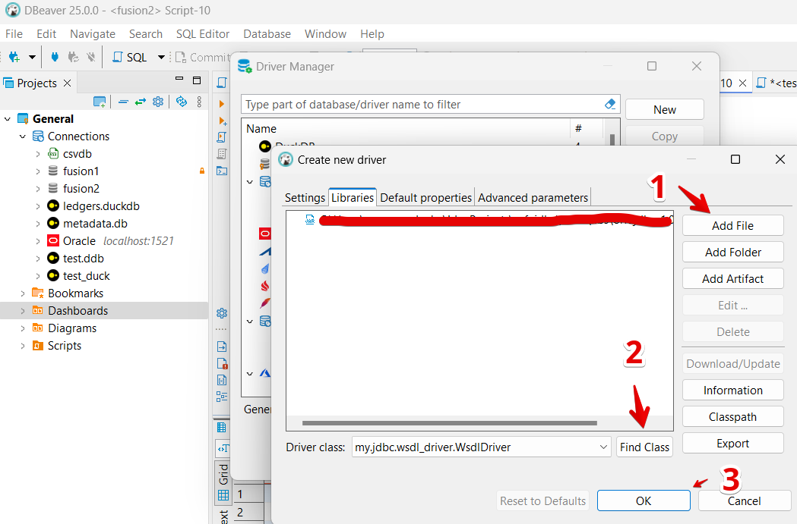
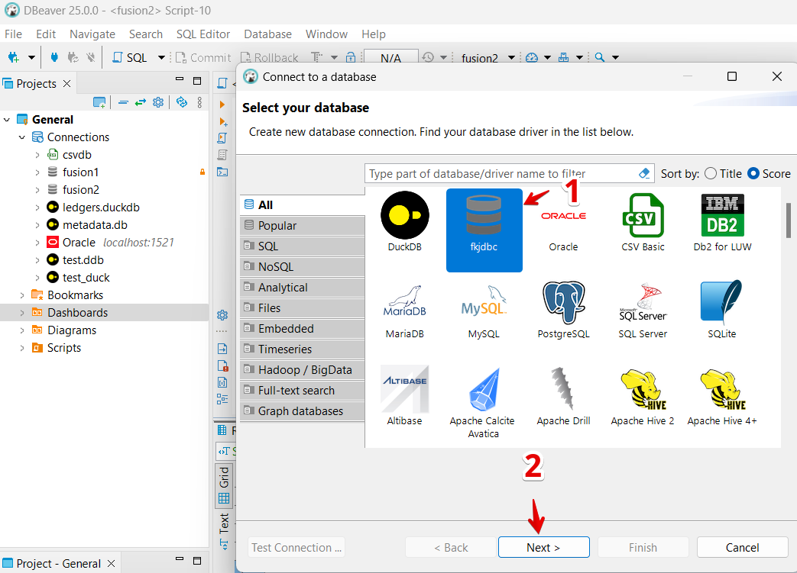
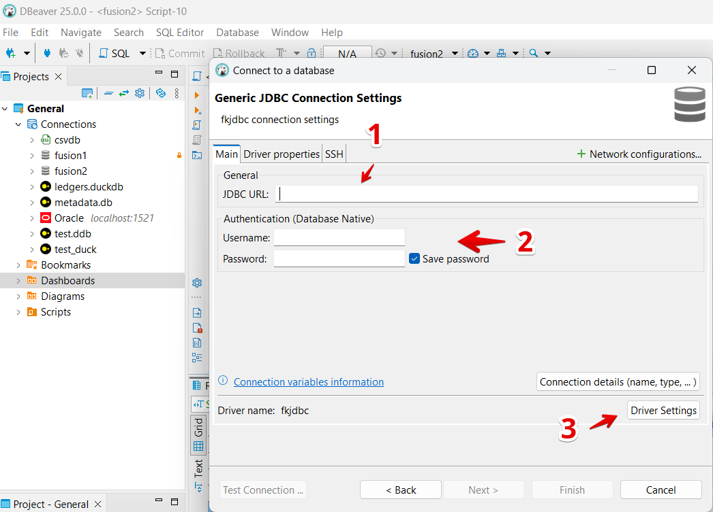
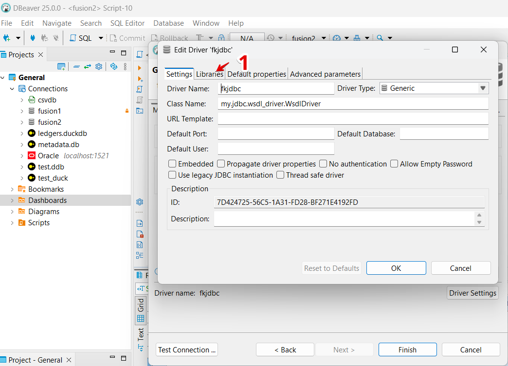
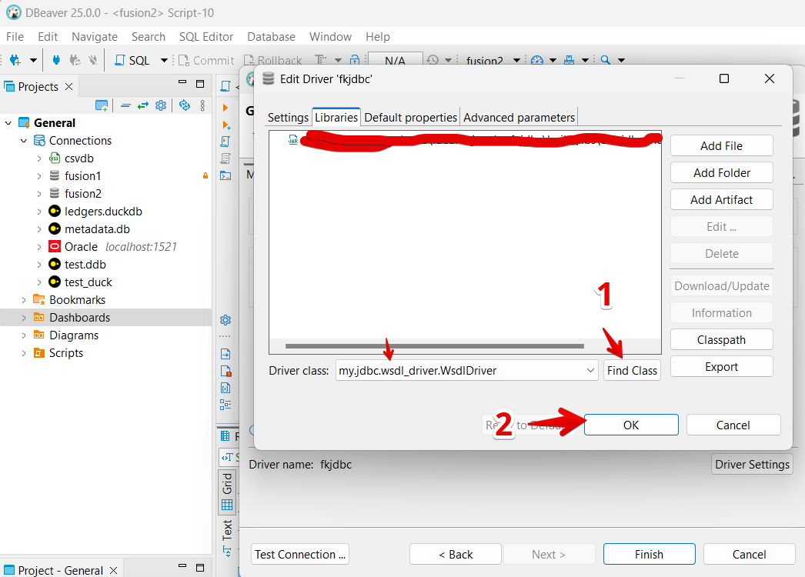
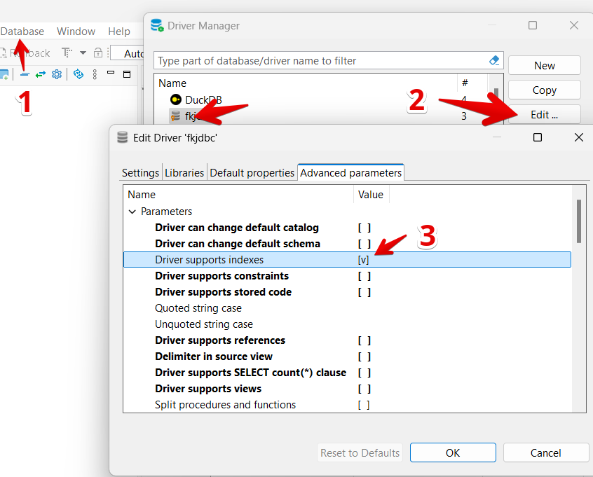

# Setup & Configuration Guide

This guide provides detailed instructions for setting up the OFJDBC driver in your SQL client.

## 🛠 Prerequisites

- **Oracle Fusion Access:** Valid credentials with access to Oracle Fusion reporting (via WSDL).
- **JDK/JRE:** A Java 8 (or later) runtime installed on your machine.
- **IDE:** A JDBC-compliant tool like DBeaver, DbVisualizer, or IntelliJ IDEA.

## 📝 Installation

1.  **Download the Driver:**
    Download the latest version (`orfujdbc-1.0-SNAPSHOT.zip`) from the [Releases page](https://github.com/krokozyab/ofjdbc/releases).

2.  **Setup Fusion Reports:**
    In your Fusion instance, un-archive `DM_ARB.xdm.catalog` and `RP_ARB.xdo.catalog` (found in the `otbireport` folder of this repository) into the `/Shared Folders/Custom/Financials` folder.
    **Recommended:** also upload `DM_ARB2_V3.xdmz` and `RP_ARB2_V3.xdoz` from the same `otbireport` folder into the same catalog folder (Catalog → **Upload**). The driver uses this newer data model when it finds it: wide and large results come back several times faster and queries may be longer than 32 KB. `CHECK SETUP` shows whether it is found.
    *Note: You can use a different folder; then name it in the connection URL (`jdbc:wsdl://<host>/<folder>`), and point each report to the data model in that folder (open the report → **Edit** → data model).*

## ⚙️ Configuration (Step-by-Step)

1.  **Place the Driver File:** Save the downloaded JAR file to a permanent location on your computer.
2.  **Register the Driver:** Open your IDE (DBeaver, DBVisualizer, IntelliJ) and open the Driver Manager to register a new driver.
3.  **Driver Settings:**
    *   **Class Name:** `my.jdbc.wsdl_driver.WsdlDriver`
    *   **Library:** Select the JAR file you saved.
    *   **URL TEMPLATE (not shown on screenshot):** `jdbc:wsdl://{host}/{database}` — in the connection, **Database** is the catalog folder of the reports (`/Custom/Financials`), and may be left empty for that folder.
        A driver set up earlier with `jdbc:wsdl://{host}/xmlpserver/services/ExternalReportWSSService?WSDL:{database}` keeps working; switch its template only together with a new driver JAR, older JARs do not read the short form.

    
    

4.  **Create Connection:** Create a new database connection using the driver you just registered.

    

5.  **Connection Details:**
    *   **JDBC URL:** `jdbc:wsdl://<your-server>.oraclecloud.com/Custom/Financials` (or the long form `jdbc:wsdl://<your-server>.oraclecloud.com/xmlpserver/services/ExternalReportWSSService?WSDL:/Custom/Financials/RP_ARB.xdo`)
    *   **Username/Password:** Your Oracle Fusion credentials.

    
    
    

6.  **Windows Users:** Enable view indexes in driver settings if required.

    

## 🩺 If Something Does Not Work

1.  **Run `CHECK SETUP`** in the SQL editor of the connection. It answers with one row per step, each OK, WARNING, FAILED or OFF with what to do:
    *   **DRIVER** — the JAR your tool loaded and when it was built: after an update, check that this is the new one.
    *   **SERVER**, **LOGIN** — where the driver connects and as whom.
    *   **REPORT** rows — whether the reports are in the folder of the URL and readable for your user.
    *   **QUERY** — `SELECT 1 FROM DUAL` and how long it took, or the error.
2.  **Report not found** — the error names the folder and files the driver looked for. Check the folder in the URL, that the catalog files are unarchived into it, and that your role may read them.
3.  **`ORA-00942` / `ORA-00904`** — the error lists the tables of your query and the names it knows that are close to the one you wrote, from the local metadata cache. `FIND FUSION TABLE '%part%'` and `FIND FUSION COLUMN 'NAME'` search further.
4.  **A query stops after 120 seconds** — it is not sent again, and the message says how to make it faster. To wait longer, add `-Dofjdbc.http.readTimeout=600` on a line after `-vmargs` in `dbeaver.ini`, or set `OFJDBC_HTTP_READ_TIMEOUT=600`.
5.  **`HELP`** lists every driver command with an example; `HELP DUCK` or `HELP JOIN KEYS` shows one area or command.

## 💡 Tips for DBeaver Users

1.  **Avoid Root Refresh:** Don’t right-click → Refresh on the “Indexes” folder of your connection root. This triggers a massive schema-wide metadata scan.
2.  **Expand Individually:** Expand the connection, then the **Tables** node, find your target table, and **only then** expand its **Indexes** subnode.
3.  **Scripting:** If you need a full index list, query `ALL_INDEXES` or `ALL_IND_COLUMNS` via SQL instead of using the UI tree.

## 🔄 Cache Management

The driver uses a local DuckDB database to cache metadata.
*   **Location:** `~/.ofjdbc/metadata.db`
*   **Invalidation:** If you update the driver or schema changes significantly, delete `metadata.db` and `metadata.db.wal` from your user folder to force a refresh.
